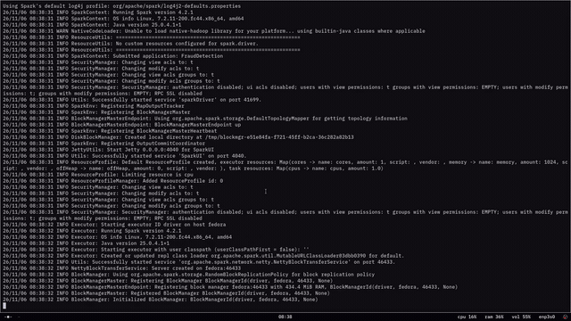

# Fraud Detection Pipeline

A distributed fraud-detection project that simulates a stream of banking transactions, uploads them to HDFS, and analyzes them for suspicious activity using **Apache Spark (PySpark)** and **Hadoop MapReduce (Java)**.

The pipeline generates realistic transaction batches (including injected fraud patterns), ships them into HDFS, and produces reports for high-value transactions, rapid transaction bursts, geographic anomalies, unusual transaction hours, and per-account spending summaries.

---

## Table of Contents

- [Overview](#overview)
- [Demo](#demo)
- [Key Features](#key-features)
- [Architecture](#architecture)
- [Technology Stack](#technology-stack)
- [Directory Structure](#directory-structure)
- [Data Model](#data-model)
- [How It Works](#how-it-works)
  - [1. Transaction Generation](#1-transaction-generation)
  - [2. Batch Upload to HDFS](#2-batch-upload-to-hdfs)
  - [3. Spark Fraud Analysis](#3-spark-fraud-analysis)
  - [4. MapReduce Account Aggregation](#4-mapreduce-account-aggregation)
- [Detection Rules](#detection-rules)
- [Prerequisites](#prerequisites)
- [Setup](#setup)
- [Running the Pipeline](#running-the-pipeline)
- [MapReduce Job](#mapreduce-job)
- [Outputs](#outputs)
- [Configuration Reference](#configuration-reference)
- [Troubleshooting](#troubleshooting)
- [Limitations and Future Work](#limitations-and-future-work)

---

## Overview

This project demonstrates an end-to-end, distributed data pipeline for fraud analytics:

1. **Generate** synthetic transactions locally (normal activity plus injected fraud patterns).
2. **Upload** new batch files to a live HDFS input directory.
3. **Analyze** the accumulated data with Spark, applying window-based and threshold-based detection rules.
4. **Aggregate** transactions per account with a classic Hadoop MapReduce job.
5. **Store** results as CSV datasets in HDFS for downstream reporting.

It is intended as a learning/reference project for Hadoop, HDFS, MapReduce, and PySpark on a single-node or small cluster setup.

---

## Demo

[](assets/demo.mp4)

Click the preview above to open the **full demo video** (3 min 24 s, 720p MP4). GitHub plays MP4 files directly in the repository viewer; if your browser downloads the file instead, open it with any video player.

The recording shows the pipeline end to end: generating transaction batches, uploading them to HDFS, running the Spark fraud analysis, and reviewing the results.

---

## Key Features

- Realistic transaction simulator with normal and suspicious behavior.
- Continuous, incremental batch ingestion into HDFS.
- Spark analysis using window functions (last 10 minutes per account).
- Five fraud indicators: high value, rapid bursts, geographic anomalies, odd hours, and account summaries.
- A Java MapReduce implementation of per-account count/total/average.
- Fault-tolerant batch writing (temp file + atomic rename) and duplicate-safe HDFS uploads.

---

## Architecture

```
┌──────────────────────────┐
│  transaction_generator   │  Writes batch_*.csv every 10 s
│  (Python, local)         │
└────────────┬─────────────┘
             │ data/raw/generated/
             ▼
┌──────────────────────────┐
│  batch_uploader          │  Detects new batches, pushes to HDFS
│  (Python + hdfs CLI)     │  (skips files already present)
└────────────┬─────────────┘
             │ hdfs put
             ▼
┌──────────────────────────────────────────────┐
│  HDFS: /fraud-detection/transactions/        │
│        live-input/                           │
└────────────┬─────────────────────────────────┘
             │
      ┌──────┴───────────────────┐
      ▼                          ▼
┌───────────────────┐   ┌─────────────────────────┐
│  Spark Analysis   │   │  Hadoop MapReduce       │
│  fraud_detection  │   │  TransactionDriver      │
│  (PySpark)        │   │  Mapper + Reducer       │
└─────────┬─────────┘   └────────────┬────────────┘
          │                          │
          ▼                          ▼
┌────────────────────────────────────────────────┐
│  HDFS: /fraud-detection/results/...             │
│  HDFS: /fraud-detection/transactions/output/    │
└────────────────────────────────────────────────┘
```

**Data flow:** local CSV batches → HDFS live input → Spark detections and/or MapReduce aggregation → HDFS result directories.

---

## Technology Stack

| Component        | Technology                          | Version / Notes                    |
| ---------------- | ----------------------------------- | ---------------------------------- |
| Storage          | Apache Hadoop HDFS                  | 3.5.0                              |
| Batch analytics  | Apache Spark (PySpark)              | 4.x (project developed on 4.2.1)   |
| MapReduce        | Hadoop MapReduce (Java)             | Java 17 source target              |
| Build tool       | Apache Maven                        | 3.8+                               |
| Scripting        | Python                              | 3.9+ (standard library only)       |
| Sorting/shuffle  | Hadoop YARN / local mode            | Depends on your Hadoop setup       |

> The Python generator and uploader use only the standard library. PySpark is provided by your Spark installation (`spark-submit`) or installed via `pip` if you run the script directly.

---

## Directory Structure

```
fraud-detection/
├── pom.xml                              # Maven build; Hadoop deps are `provided`
├── README.md
├── assets/
│   ├── demo.mp4                         # Demo video (720p, compressed for GitHub)
│   └── demo-preview.gif                 # Animated preview embedded above
├── src/
│   ├── main/
│   │   ├── java/
│   │   │   └── com/fraud/mapreduce/
│   │   │       ├── TransactionDriver.java    # MapReduce job configuration/entry point
│   │   │       ├── TransactionMapper.java    # Parses CSV, emits (account_id, amount)
│   │   │       └── TransactionReducer.java   # Emits (account_id, count,total,average)
│   │   └── python/
│   │       ├── transaction_generator.py      # Simulates normal + suspicious transactions
│   │       └── fraud_detection.py            # PySpark analysis and HDFS output
│   └── python/
│       └── batch_uploader.py                 # Watches local batches, uploads to HDFS
├── data/
│   ├── raw/
│   │   ├── transactions.csv                  # Small static sample dataset
│   │   └── generated/                        # Runtime batches written by the generator
│   └── processed/                            # Reserved for post-processed output
├── build/                                    # Reserved/empty build workspace
├── test-data/                                # Reserved/empty test fixtures
└── target/                                   # Maven build output (generated)
    ├── classes/com/fraud/mapreduce/*.class
    └── fraud-detection-1.0-SNAPSHOT.jar
```

**Notes**

- `data/raw/generated/`, `build/`, `test-data/`, and `data/processed/` are runtime/placeholder directories and may be empty in a fresh clone.
- `target/` is produced by Maven and is not source.
- The uploader currently lives in `src/python/` while the other scripts live in `src/main/python/`. Keep this in mind when running commands, or move it for consistency.

---

## Data Model

All transactions are CSV files with the following six columns:

| Column             | Type     | Description                                | Example                    |
| ------------------ | -------- | ------------------------------------------ | -------------------------- |
| `transaction_id`   | string   | Unique transaction identifier              | `TXN-57AB5882`             |
| `account_id`       | string   | Account that made the transaction          | `ACC113`                   |
| `amount`           | double   | Transaction amount                         | `6563.71`                  |
| `timestamp`        | ISO-8601 | When the transaction occurred              | `2026-11-06T02:39:02`      |
| `location`         | string   | City where the transaction happened        | `Chennai`                  |
| `transaction_type` | string   | `UPI`, `CARD`, or `BANK_TRANSFER`          | `UPI`                      |

Sample header and row:

```csv
transaction_id,account_id,amount,timestamp,location,transaction_type
TXN001,ACC101,500,2026-11-06T09:00:00,Bengaluru,UPI
```

The generator uses 20 accounts (`ACC101`–`ACC120`), six Indian cities, and three transaction types.

---

## How It Works

### 1. Transaction Generation

`src/main/python/transaction_generator.py`

- Creates batches of 20 normal transactions (`amount` between 100 and 10,000).
- With a 40% probability, injects a suspicious pattern: 3 large transactions (50,000–150,000) from 3 different cities within a few minutes.
- Writes each batch atomically: a `.tmp` file is written first, then renamed to `batch_<timestamp>_<uuid>.csv` in `data/raw/generated/`.
- Loops forever, producing a batch every 10 seconds. Stop with `Ctrl+C`.
- Filenames include a timestamp and UUID to stay unique across restarts.

### 2. Batch Upload to HDFS

`src/python/batch_uploader.py`

- Ensures the HDFS directory `/fraud-detection/transactions/live-input` exists.
- Polls `data/raw/generated/` every 5 seconds for `batch_*.csv`.
- Before uploading, checks whether the file already exists in HDFS and skips duplicates.
- Tracks processed files in memory and logs each upload.
- Stop with `Ctrl+C`.

### 3. Spark Fraud Analysis

`src/main/python/fraud_detection.py`

- Starts a Spark session named `FraudDetection`.
- Reads all CSV files from `hdfs://localhost:9000/fraud-detection/transactions/live-input` with header and schema inference.
- Casts `timestamp` to a Spark timestamp and derives:
  - `transaction_hour` (0–23)
  - `event_time` (Unix seconds)
- Builds a 10-minute (`-600` seconds) window per account ordered by `event_time`:
  - `recent_transaction_count` — number of transactions in the window
  - `recent_locations` — set of cities seen in the window
- Produces the five result datasets described in [Detection Rules](#detection-rules).
- Prints each dataset to the console and writes CSV output to HDFS (overwrite mode).
- Runs as a one-shot batch job and then stops the Spark session.

### 4. MapReduce Account Aggregation

The Java job in `src/main/java/com/fraud/mapreduce/` is a classic word-count-style aggregation:

- **Mapper** (`TransactionMapper`)
  - Skips the CSV header.
  - Ignores malformed rows (must have exactly 6 fields).
  - Emits `(account_id, amount)`.
  - Skips rows with unparsable amounts.
- **Reducer** (`TransactionReducer`)
  - Counts transactions and sums amounts per account.
  - Emits `account_id, count, total, average`.
- **Driver** (`TransactionDriver`)
  - Requires exactly two arguments: input path and output path.
  - Configures map/reduce classes and output types.

This job is independent of the Spark script: use it when you want a lightweight Hadoop-only aggregation.

---

## Detection Rules

| Dataset                  | Rule                                                                                       | Output path (HDFS)                                  |
| ------------------------ | ------------------------------------------------------------------------------------------ | --------------------------------------------------- |
| Account summary          | Group by `account_id`: count, total amount, average amount                                 | `/fraud-detection/results/account-summary`          |
| High-value transactions  | `amount >= 50000`                                                                          | `/fraud-detection/results/high-value`               |
| Rapid transactions       | `recent_transaction_count >= 3` within a 10-minute window per account                      | `/fraud-detection/results/rapid-transactions`       |
| Geographic anomalies     | `size(recent_locations) >= 2` **and** (`amount >= 50000` **or** `recent_transaction_count >= 3`) | `/fraud-detection/results/geographic-anomalies` |
| Unusual hours            | `transaction_hour >= 0` and `transaction_hour < 5` (midnight–5 AM)                          | `/fraud-detection/results/unusual-hours`            |

Thresholds are hardcoded in `fraud_detection.py` and can be adjusted (see [Configuration Reference](#configuration-reference)).

---

## Prerequisites

- **Java 17+** (Java 17 recommended; very new JDKs may need Spark compatibility flags).
- **Apache Hadoop 3.5.0** installed and on your `PATH` (`hadoop`, `hdfs`).
- **Apache Spark 4.x** with `spark-submit` on your `PATH`.
- **Apache Maven 3.8+**.
- **Python 3.9+**.
- A running HDFS instance (single-node is fine). Verify with:

```bash
hdfs dfs -ls /
```

- Optional: YARN if you want to run jobs on a cluster rather than in local mode.

Example environment (adjust to your installation):

```bash
export JAVA_HOME=/usr/lib/jvm/java-17-openjdk
export HADOOP_HOME=/usr/local/hadoop
export SPARK_HOME=/opt/spark
export PATH="$HADOOP_HOME/bin:$HADOOP_HOME/sbin:$SPARK_HOME/bin:$PATH"
```

---

## Setup

### 1. Clone the repository

```bash
git clone https://github.com/MaddelaTarun/fraud-detection.git
cd fraud-detection
```

### 2. Start HDFS

If HDFS is not already running:

```bash
start-dfs.sh
jps   # should list NameNode, DataNode, SecondaryNameNode
```

Check the default filesystem URI (the Spark script assumes `hdfs://localhost:9000`):

```bash
hdfs getconf -confKey fs.defaultFS
```

If it differs, update `INPUT_PATH`/`OUTPUT_BASE` in `src/main/python/fraud_detection.py`.

### 3. Create HDFS directories

```bash
hdfs dfs -mkdir -p /fraud-detection/transactions/live-input
hdfs dfs -mkdir -p /fraud-detection/results
```

### 4. Set up Python

The generator and uploader need no third-party packages. If you plan to run the Spark script with `python` instead of `spark-submit`:

```bash
python3 -m venv .venv
source .venv/bin/activate
pip install pyspark
```

### 5. Build the Java project

```bash
mvn clean package
```

This produces `target/fraud-detection-1.0-SNAPSHOT.jar`. Hadoop dependencies are marked `provided`, so they are supplied by your Hadoop installation at runtime.

---

## Running the Pipeline

Use **three terminals** for the streaming simulation, plus one for analysis.

### Terminal 1 — Generate transactions

```bash
cd fraud-detection
python3 src/main/python/transaction_generator.py
```

Batches appear in `data/raw/generated/` every 10 seconds.

### Terminal 2 — Upload batches to HDFS

```bash
cd fraud-detection
python3 src/python/batch_uploader.py
```

Files are uploaded to `/fraud-detection/transactions/live-input`.

### Terminal 3 — Run the Spark analysis

Let the generator/uploader accumulate a few batches first, then run:

```bash
cd fraud-detection
spark-submit src/main/python/fraud_detection.py
```

You can re-run this command whenever you want a fresh analysis of everything currently in `live-input`. Results are written with overwrite mode.

> **Important:** the Spark job reads *all* files currently in `live-input` on every run. To analyze only new data, archive or delete the processed files from HDFS first.
>
> ```bash
> hdfs dfs -mkdir -p /fraud-detection/transactions/archive
> hdfs dfs -mv /fraud-detection/transactions/live-input/batch_*.csv \
>   /fraud-detection/transactions/archive/
> ```

### Verify uploads

```bash
hdfs dfs -ls /fraud-detection/transactions/live-input
hdfs dfs -ls -R /fraud-detection/results
```

---

## MapReduce Job

The MapReduce aggregation expects **CSV input** and an output directory that does **not** already exist.

```bash
# Upload the sample dataset (or any batch) to HDFS
hdfs dfs -mkdir -p /fraud-detection/transactions/input
hdfs dfs -put -f data/raw/transactions.csv /fraud-detection/transactions/input/

# Remove a previous output directory
hdfs dfs -rm -r -f /fraud-detection/transactions/output

# Run the job
hadoop jar target/fraud-detection-1.0-SNAPSHOT.jar \
  com.fraud.mapreduce.TransactionDriver \
  /fraud-detection/transactions/input \
  /fraud-detection/transactions/output

# Inspect the output
hdfs dfs -cat /fraud-detection/transactions/output/part-r-00000
```

Expected output format (tab-separated):

```
ACC101	4,3000.0,750.0
ACC102	2,1500.0,750.0
ACC103	2,3200.0,1600.0
```

Where each value is `count,total,average`.

To run against the live batches instead:

```bash
hdfs dfs -rm -r -f /fraud-detection/transactions/output
hadoop jar target/fraud-detection-1.0-SNAPSHOT.jar \
  com.fraud.mapreduce.TransactionDriver \
  /fraud-detection/transactions/live-input \
  /fraud-detection/transactions/output
```

---

## Outputs

### Spark outputs

Each directory contains one or more `part-*.csv` files plus a `_SUCCESS` marker:

| Directory                     | Contents                                                                 |
| ----------------------------- | ------------------------------------------------------------------------ |
| `account-summary`             | `account_id, transaction_count, total_amount, average_amount`            |
| `high-value`                  | Full transaction rows with `amount >= 50000`                             |
| `rapid-transactions`          | Transactions in bursts, with `recent_locations` flattened to a string    |
| `geographic-anomalies`        | Multi-city high-value/burst transactions                                 |
| `unusual-hours`               | Transactions between midnight and 5 AM                                   |

Fetch a report locally:

```bash
hdfs dfs -getmerge /fraud-detection/results/account-summary data/processed/account-summary.csv
```

### MapReduce output

- HDFS: `/fraud-detection/transactions/output/part-r-00000`
- Format: `account_id<TAB>count,total,average`

---

## Configuration Reference

| Setting                     | Location                            | Default                                                    |
| --------------------------- | ----------------------------------- | ---------------------------------------------------------- |
| Spark input path            | `src/main/python/fraud_detection.py`| `hdfs://localhost:9000/fraud-detection/transactions/live-input` |
| Spark output base           | `src/main/python/fraud_detection.py`| `hdfs://localhost:9000/fraud-detection/results`            |
| High-value threshold        | `src/main/python/fraud_detection.py`| `amount >= 50000`                                          |
| Rapid-transaction threshold | `src/main/python/fraud_detection.py`| `recent_transaction_count >= 3`                            |
| Window length               | `src/main/python/fraud_detection.py`| `rangeBetween(-600, 0)` (10 minutes)                       |
| Unusual-hour range          | `src/main/python/fraud_detection.py`| `0 <= hour < 5`                                            |
| Local batch directory       | `transaction_generator.py`, `batch_uploader.py` | `data/raw/generated`                            |
| HDFS upload directory       | `batch_uploader.py`                 | `/fraud-detection/transactions/live-input`                 |
| Batch size / interval       | `transaction_generator.py`          | 20 transactions, every 10 seconds                          |
| Upload poll interval        | `batch_uploader.py`                 | 5 seconds                                                  |
| Generated account IDs       | `transaction_generator.py`          | `ACC101`–`ACC120`                                          |
| Hadoop version              | `pom.xml`                           | `3.5.0`                                                    |
| Java release                | `pom.xml`                           | `17`                                                       |

---

## Troubleshooting

| Symptom | Cause / Fix |
| ------- | ----------- |
| `hdfs: command not found` | Add `$HADOOP_HOME/bin` and `$HADOOP_HOME/sbin` to `PATH`. |
| `Connection refused` / NameNode unavailable | HDFS is not running. Start it with `start-dfs.sh` and check `jps`. |
| `Output directory already exists` (MapReduce) | Delete the output path: `hdfs dfs -rm -r -f <output>`. |
| Spark job sees no rows | `live-input` is empty. Run the generator and uploader first, then verify with `hdfs dfs -ls`. |
| Spark reports path/port errors | `fs.defaultFS` does not match `hdfs://localhost:9000`. Check `hdfs getconf -confKey fs.defaultFS` and update the script. |
| Java module/illegal-access errors | Use Java 17 for both Maven and Spark (`JAVA_HOME`). |
| MapReduce job ignores rows | Input rows must have exactly 6 comma-separated fields; the header must start with `transaction_id`. |
| Uploader keeps re-uploading after restart | It rescans local files on restart, but checks HDFS first, so duplicates are skipped. Processed state is in-memory only. |
| Results double-count after re-running Spark | The job re-reads all accumulated files in `live-input`. Archive/delete processed batches. |
| `spark-submit` not found | Set `SPARK_HOME` and add `$SPARK_HOME/bin` to `PATH`, or invoke `$SPARK_HOME/bin/spark-submit`. |

---

## Limitations and Future Work

- **Batch, not true streaming:** the Spark job is a one-shot microbatch over accumulated files. Spark Structured Streaming with checkpointing would enable continuous processing.
- **Duplicate risk:** results are recomputed from all files in `live-input`; there is no transaction-id deduplication.
- **Hardcoded configuration:** paths and thresholds are constants inside the scripts rather than external config/env variables.
- **No automated tests:** the `test-data/` directory is a placeholder.
- **Single-node assumptions:** HDFS paths and `localhost:9000` assume a local installation.
- **Output overwrite:** Spark results are overwritten each run; use a timestamped output directory for history.
- **Possible improvements:** Kafka ingestion, a proper streaming sink, fraud scoring/ML model, partitioned output by date, and unit tests for mapper/reducer logic.

---

## License

No license file is included in this repository. Add one if you intend to distribute or reuse the code.
